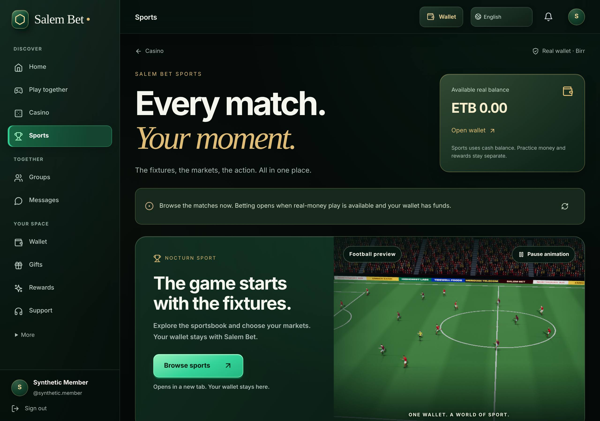
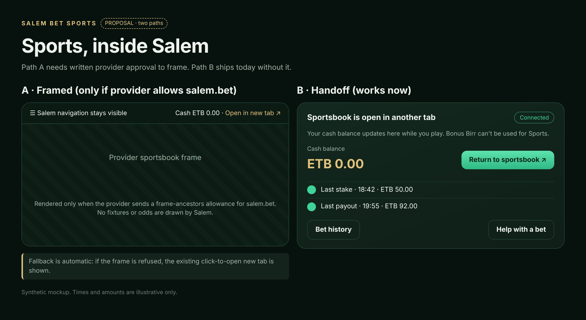
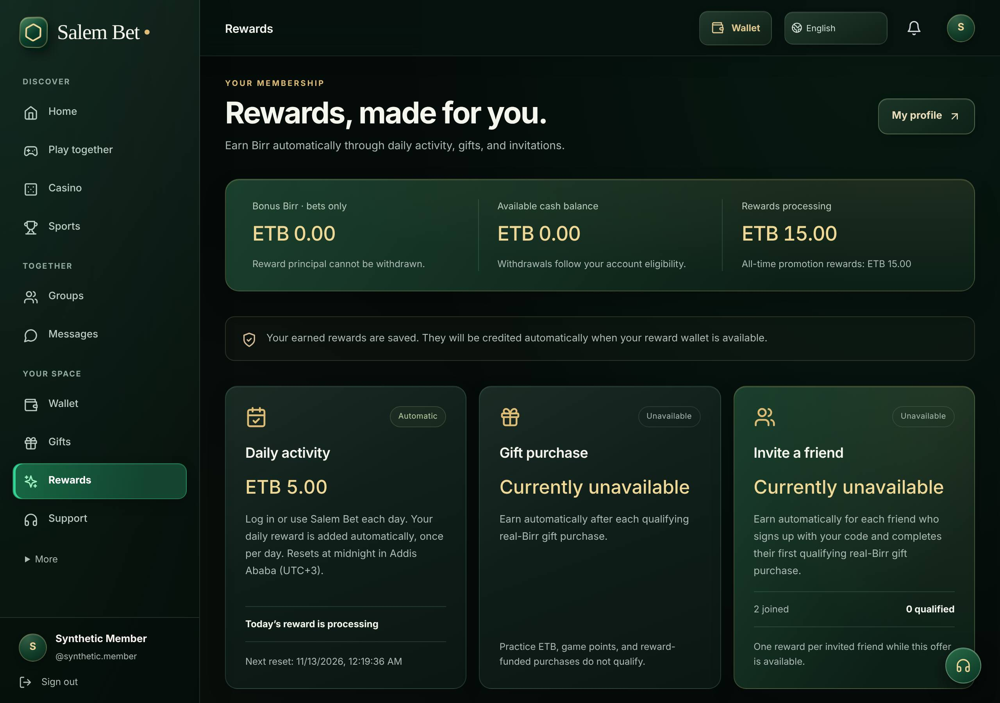
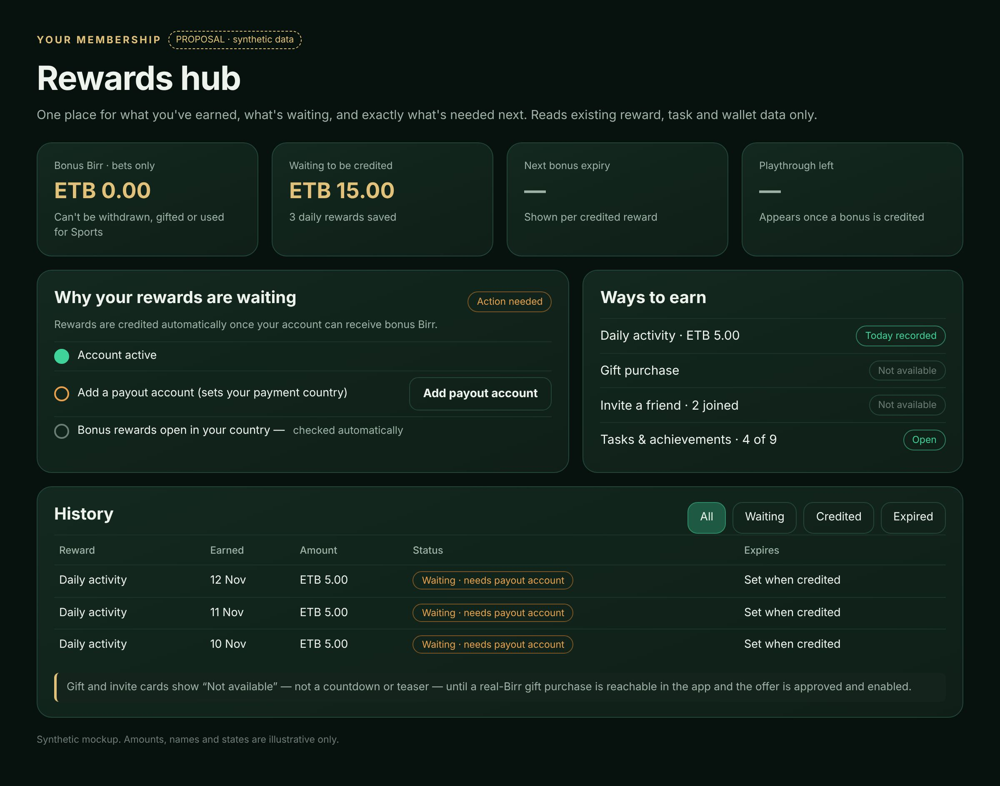
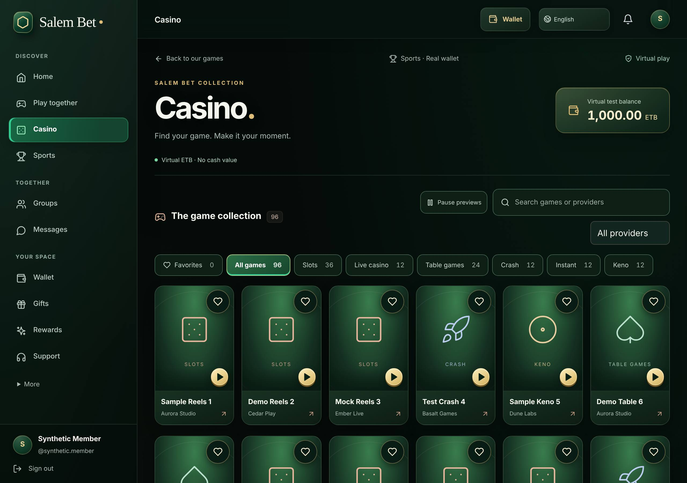
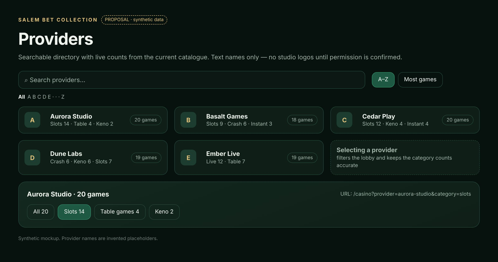
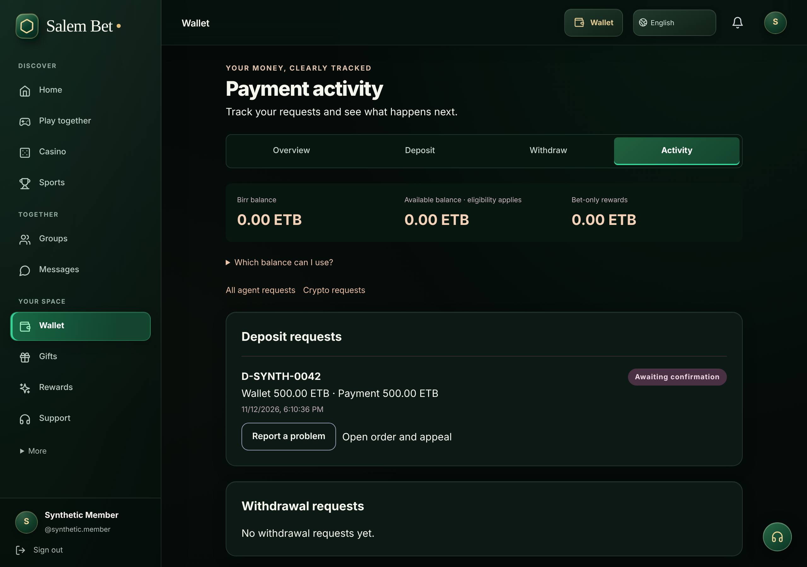
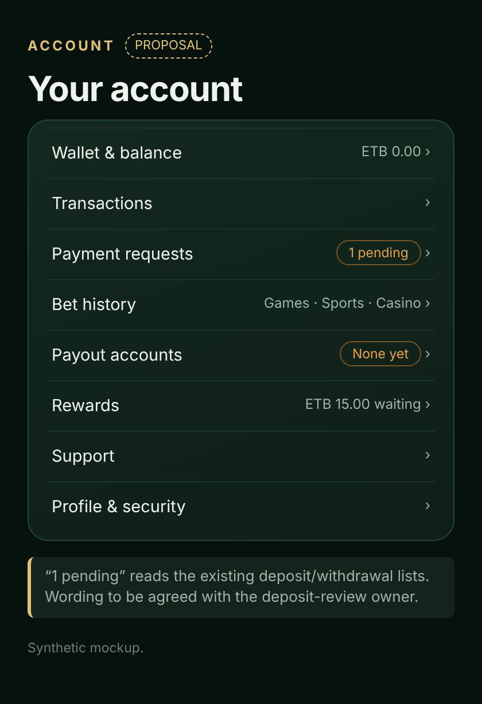

# Salem Bet usability gap review: sports, casino discovery, rewards, account

Base: `codex/casino-catalogue-20261107` at `a54696e`. This is a review and proposal only.
No application code, configuration, gate, amount, eligibility rule, balance or production
setting was changed. No bet was placed, no reward claimed, no fund moved, no access granted.

Screenshots come from a local loopback build with synthetic API responses. Every
non-loopback request was blocked. Mockups are static HTML with synthetic data
([prototype/mockups.html](prototype/mockups.html)). Names such as "Synthetic Member",
"Aurora Studio" and "D-SYNTH-0042" are invented.

**Limits of this review**

- SoftAggregator's public docs (`softaggregator.com/docs.html`) could not be reached from
  this environment. Provider facts come from the repo's records: `docs/softaggregator-test.md`,
  `docs/softaggregator-demo.md` (both cite the docs as checked on 2026-11-04) and the code
  comment that Nocturn Sport sends `X-Frame-Options: SAMEORIGIN`. Before relying on them,
  re-check them against the provider and confirm them in writing.
- I did not visit Bunabet. The "Bunabet ideas" here are the patterns named in the brief:
  sports kept inside the site's navigation, a rewards hub, a provider directory with counts,
  and account items that are easy to find. I copied no layout, odds, fixtures or branding.
- **Staff access:** that work is PR #77 (`claude/confident-bell-0o4zd4`). This review does
  not touch auth, roles, provisioning or staff routes.
- **Deposit review:** no `deposit-review` branch exists on origin. The pending-deposit
  status UI is already in this release through the agent-payments work
  (`docs/reviews/agent-payments-20261107/implementation.md`). Section 4 proposes only
  navigation-level ideas, marked *coordinate first*.

---

## Priority summary

| # | Priority | Area | Gap | Kind | Needs approval |
|---|---|---|---|---|---|
| R1 | **P0** | Rewards | Gift and referral rewards cannot be earned through the member app. The only qualifying path, `POST /gifts`, has no UI caller. Do not publish launch messaging for them. | Fact / messaging | Business |
| R2 | **P0** | Rewards | Activity & achievements (tasks, achievement list, VIP, level) is unreachable. `/rewards` was repointed on 2026-11-05 and the old page is orphaned. | Incomplete | — |
| A1 | **P1** | Account | An active payout account is what lets members receive rewards, buy real gifts and use sports. It can only be added from inside the Withdraw form. | Findability | — |
| R3 | **P1** | Rewards | "Waiting" rewards don't say what to do. Per-reward expiry and playthrough progress aren't shown. | Clarity | — |
| A2 | **P1** | Account | Bet history is split three ways: own games in `/games/history`, sports (last 20) on `/sports`, casino test wallet on `/casino`. None of them is in the main navigation. | Findability | — |
| S1 | **P1** | Sports | Sports always opens in English (`lang: 'en'`), even though the interface has eight languages. | Gap | Provider (language codes) |
| S2 | **P2** | Sports | A sportsbook framed inside Salem is blocked by the provider (`X-Frame-Options: SAMEORIGIN`). The existing new-tab handoff can be improved now. | Constraint | **Provider** to allow framing |
| C1 | **P2** | Casino | The provider filter is a bare `<select>`: no counts, no search, no shareable URL state. | Discovery | Logos: provider/legal |
| C2 | **P2** | Casino | Search, category and provider reset on Back or reload. You can't link to a filtered view. | Discovery | — |
| A3 | **P2** | Account | No single account menu. On phones, Rewards, Support, Transactions and Bet history are only in the slide-out menu, and the support button is hidden on Casino, Sports and game pages. | Findability | — |
| S3 | **P3** | Sports | "Account unavailable" covers several causes (no payout account, country, identity tier). The member can't tell which. | Clarity | Compliance (wording) |
| D1 | **P3** | Deposits | A pending-request badge in navigation. | Idea | *Coordinate with deposit-review owner* |

---

## 1. Sports



### What is already implemented (keep as is)

- **Real-wallet admission is checked on every stake.** `sportsAdmission`
  (`apps/api/src/providers/softaggregator/sports-wallet.ts:38`) requires
  `SOFTAGGREGATOR_SPORTS_LIVE_ENABLED`, the `CASINO_PLAY` and `SPORTSBOOK_PLAY` platform gates,
  an ET jurisdiction resolved from the active payout account, and the policy's identity tier
  (`:51`). Callbacks re-run the check and keep immutable receipts.
- **Sports uses withdrawable cash only.** `sportsCashBalance` (`sports-wallet.ts:28`) sums only
  WITHDRAWABLE lots. Bonus (RESTRICTED) Birr is reported as `rewardBalanceMinor` but can't be
  staked.
- **Launch safety is in place.** The game ID is pinned. The catalogue is re-verified. Launch
  hosts must match an exact allowlist. A response containing a secret is refused. The launch
  needs a one-time click intent (`apps/web/src/pages/sports.tsx:164`, `sports-launch.tsx`). The
  URL never sits in the DOM: it is used once by `window.location.replace`
  (`apps/web/src/lib/sports-launch.ts:16`).
- **The framing restriction is respected.** The code records `X-Frame-Options: SAMEORIGIN`
  from Nocturn Sport (`sports-launch.ts:16`). The page opens in a separate tab with
  `noopener noreferrer`.
- **The football preview is illustrative only.** It shows no fixtures, odds or markets
  (`apps/web/src/components/sports/football-preview.tsx:9`).
- **Live betting is off.** As of the last recorded deploy, `SOFTAGGREGATOR_SPORTS_LIVE_ENABLED=false`
  (`docs/reviews/play-together-20261105/review-repairs-20261106.md`). Sports is browse-only.

### Can the sportsbook stay inside Salem's navigation?

**Not with the provider as it is configured today.** `X-Frame-Options: SAMEORIGIN` tells
browsers to refuse any frame that isn't on the provider's own origin. A CNAME such as
`sports.salem.bet` would not change that, because it is still a different origin from
`salem.bet`. Only the provider can lift the restriction. We must not proxy, rewrite headers
or scrape around it.

**Path A: framed (needs provider approval).** Ask SoftAggregator/Nocturn whether they can:

1. replace XFO with `Content-Security-Policy: frame-ancestors https://salem.bet` for this
   operator, or offer an embeddable widget or SDK;
2. document any `postMessage` events (balance changed, bet placed, session ended) and the
   allowed origins;
3. confirm the supported `lang` codes (am, om, ti, so, ar, fr, sw, en?) and whether `homeurl`
   or `exiturl` work inside a frame.

If they approve, Salem would render the existing launch URL in a sandboxed `<iframe>` only
after a client-side check that the frame actually loaded. The current click-to-open new tab
stays as the automatic fallback. The launch rules (click intent, allowlisted host, no URL
logging) stay the same. The frame `src` would sit in the DOM, as the casino iframe's already
does (`provider-test.tsx:543`). Security should accept that before go-live.

**Path B: better handoff (no approval needed; recommended now).**



- Once the tab is opened, show a "Sportsbook open in another tab" state on `/sports`. Include
  a "Return to sportsbook" button that creates a fresh, user-initiated intent. Never reuse an
  old URL.
- Refresh status and activity on `visibilitychange` and `focus`, as well as on the existing
  10 s/15 s timers.
- Show bonus Birr as "not usable for Sports" from the existing `rewardBalanceMinor`
  (`sports.tsx:21`). Today it says only "rewards stay separate".
- Point the back link to Home (or keep both), not only to Casino (`sports.tsx:85`). Show the
  support button on `/sports`, which `layout.tsx:51` currently hides.
- **S1:** pass the interface language to `getGame` instead of `lang: 'en'`
  (`sports-client.ts:78`), mapped to the provider's codes with `en` as fallback. This is a
  small API change behind the existing launch and needs the provider's code list.
  `homeurl` is also hard-coded to production (`:81`). Make it environment-driven so staging
  doesn't return players to production.
- **S3:** split `account-unavailable` into `payout-account-required`, `country-unavailable` and
  `verification-required`. These are message codes only; eligibility logic is unchanged.
  Compliance should approve the wording.

---

## 2. Rewards



### What exists today

| Reward | Earned when | Credited as | Source |
|---|---|---|---|
| Daily | First visible authenticated activity per Addis day (UTC+3), if `daily_enabled` | Bonus Birr | `member-rewards/service.ts:58,174`, `lib/use-automatic-rewards.ts` |
| Gift | A real-Birr gift purchase through `sendGift`, at or above `gift_minimum`, while `gift_enabled`, up to `gift_daily_limit` per Addis day | Bonus Birr | `member-rewards/service.ts:135-157`, `economy/gift-service.ts:267` |
| Referral | The referred friend's first qualifying real-Birr gift **while `referral_enabled`**. Paid once per referral. | Bonus Birr to the inviter | `service.ts:158-170`, migration `…_member_rewards/migration.sql:42` |
| Tasks / achievements | Existing task and achievement engine (claim per task) | XP, game points and optional bonus Birr | `rewards/reward-service.ts`, page `pages/rewards.tsx` |

How every bonus Birr credit is made (`rewards/reward-service.ts:86-130`):

- It needs `tryActiveBonusGrantPolicy` (`economy/jurisdiction-service.ts:142`): an **active
  payout account**, the `BONUS_GRANT` gate, and an active country policy.
- Without that policy, member promotion rewards stay as durable entitlements. The 30 s
  delivery loop credits them later.
- Credits go to a RESTRICTED lot with `bonusRule NET_WINNINGS_V1`.
- The playthrough requirement is `ceil(amount × policy.playthroughMultiplier)`.
- Expiry is `bonusExpiryHours` counted **from the moment of credit, not of earning**.

### R1: real-gift qualification (verified; blocks launch messaging)

What a gift must satisfy to earn a reward:

1. The gift goes through `sendGift` in `apps/api/src/economy/gift-service.ts`. That is the
   only caller of `recordPaidGiftRewards`.
2. The sender has an ACTIVE payout account in a country whose policy has `giftDailyLimit > 0`
   (`jurisdiction-service.ts:123`, called at `gift-service.ts:165`).
3. It is paid **only from withdrawable cash lots**. Bonus Birr is refused
   (`economy/coin-ledger-service.ts:455`).
4. Its total is at least `gift_minimum`, and a `GIFT_SPEND` economic operation exists for it
   (`member-rewards/service.ts:141`).
5. The gift reward is granted only if today's gift rewards plus one more stay within
   `gift_daily_limit`. There is no partial reward: with a limit of 25 and an amount of 10,
   a member gets two rewards (`service.ts:146`).

**Finding:** the member Gifts page (`/gifts` → `components/gifts/gift-collection.tsx`) calls
`/gift-collection`. That route uses either:

- the practice-ETB service, when `PRACTICE_ETB_ENABLED` is on (`gift-collection/routes.ts:11`), or
- the collectible service, which buys with **game points** (`gift-collection/service.ts:117`).

Neither calls `recordPaidGiftRewards`. The web client's `api.sendGift` (`lib/api.ts:607`) has
no caller in any page.

**So no member can currently earn a gift reward or a referral reward through the app,**
whatever the admin settings say.

The rewards page copy implies otherwise:

- "Earn automatically after each qualifying real-Birr gift purchase"
- "…completes their first qualifying real-Birr gift purchase" (`member-rewards.tsx:209`)

The admin can enable both offers, but the copy would then promise something that can't happen.

Related wording issues:

- **Two day boundaries.** The jurisdiction gift spending limit resets at **UTC midnight**
  (`gift-service.ts:216`), but the reward cap resets at **Addis midnight** (21:00 UTC). Any
  "per day" messaging must say which one it means.
- **"First" purchase.** The referral pays on the friend's first qualifying gift *made while the
  offer is enabled*, not their first gift ever.

**Decision needed (business):** either build or reveal a real-Birr gift purchase in the app
(a product and compliance decision that this review doesn't make), or keep the gift and
referral offers disabled and mark them "Not available" instead of "Earn automatically…".
Do not announce either offer until one of those happens.

### R2: Activity & achievements is orphaned

`pages/rewards.tsx` (tasks with Claim, achievements, VIP, level/XP; heading at `:142`) has
had no route since `59c2c5f` (2026-11-05), when `/rewards` was repointed to
`MemberRewardsPage` (`App.tsx:155`). The heading was changed to an h2, which suggests it was
meant to be embedded, but it was never added.

`components/member/dashboard-highlights.tsx:239` still promises "View tasks and achievements"
at `/rewards`. That component is itself not mounted. The page's labels are also not
translated.

The fix is small and safe: mount the existing component as a section or tab of the rewards
hub, translate its labels, and keep its existing APIs and claim flow. Its 14 tests already
exist (`rewards.test.tsx`).

### R3: proposed rewards hub (one hub, no second engine)



The hub reads only these existing sources:

- `GET /member-rewards`
- `/tasks`, `/achievements`, `/vip`, `/progress`
- `/wallet` (`coinAvailability`)

It adds **one read-only member endpoint** for the member's own open RESTRICTED lots:
amount, `expiresAt`, requirement amount and progress. The data is already in
`coin_provenance` (admin-only today, via `economy/ledger-admin-routes.ts`). The endpoint
would add no writes and touch no amounts or eligibility.

What the hub shows:

- **Eligibility checklist** in place of "credited when your reward wallet is available"
  (`member-rewards.tsx:124`): account active → payout account added → bonus open in your
  country. Showing *which* step fails needs a reason code alongside `canClaim`
  (`service.ts:334`). That is a read-only change.
- **History filters** (Waiting / Credited / Expired) and an expiry date per credited reward.
- **Restriction copy taken from the code**: bonus Birr is bets-only; it can't buy gifts
  (`coin-ledger-service.ts:455`), be used for sports (`sports-wallet.ts:28`) or be withdrawn.
- **Unavailable states** shown as "Not available", with no amounts or countdowns, whenever an
  offer is disabled or (per R1) unreachable.

---

## 3. Casino discovery



### What is already implemented (keep)

- Search across title and provider (`provider-test.tsx:239`).
- Category chips with counts that follow search and provider (`:343`). Favorites are kept per
  account on the device. "Show more" never truncates silently.
- The classifier repairs mislabelled Keno, Table and Crash titles and keeps sportsbooks out
  (`providers/softaggregator/game-categories.ts`).
- Artwork motion respects reduced motion and data saving.
- Launch failures show safe, specific messages.
- A restricted iframe with a new-tab fallback.
- The page heading is Salem-branded ("SALEM BET COLLECTION").

### Gaps and proposals



- **C1: provider directory.** Today it is a native `<select>` sorted A–Z with no counts
  (`provider-test.tsx:315,608`). Proposal:
  - a searchable "Providers" sheet: A–Z or "most games", a per-provider total, and a breakdown
    by category, all computed client-side from the already-loaded catalogue;
  - selecting a provider sets the existing `provider` filter;
  - text names only.

  Provider logos need permission from the provider or the studios (**business/legal
  decision**). Provider names come straight from `provider_name || provider`
  (`test-client.ts:195`). Variants such as "PopOK" and "PopOK Gaming" may appear as separate
  providers. Normalise them only after reviewing a real catalogue export, so no studio is
  merged by mistake.
- **C2: URL state.** Mirror `q`, `category` and `provider` into the query string with
  `replace` navigation, so Back, reload and shared links keep the view. The existing
  `game`/`intent` launch parameters must still need a fresh click. A filter URL must never
  launch a game.
- **Counts only where the data supports them.** Category and provider counts are exact for the
  loaded catalogue, so show them. Do not show "players online", "popular" or "new" without a
  real data source. None exists today.
- **Small fixes:**
  - "Recent test wallet activity" doesn't say which game a movement belongs to; the movements
    response has no game ID.
  - The casino balance uses `en-US` formatting rather than the interface locale (`:400`).

---

## 4. Account and deposits



| Item | Where it is | Reachable from nav? |
|---|---|---|
| Transactions | `/wallet` "Transaction History" (`wallet.tsx:174`). Not shown when the practice wallet replaces the overview. | Wallet → scroll |
| Payment requests (pending deposits/withdrawals) | `/wallet/activity` (`wallet-navigation.tsx:24`). Statuses such as "Awaiting confirmation" (`wallet-payments.tsx:1044`) and an order room with appeals. | Wallet → Activity tab |
| Bet history | Own games: `/games/history` (`games/history.tsx:118`). Sports: last 20 on `/sports` (`sports-routes.ts:56`). Casino: test wallet on `/casino` (`provider-test.tsx:831`). | **No.** Linked from Home and game pages only |
| Payout accounts | Only inside Withdraw: "Add a payout account" (`wallet-payments.tsx:647`). Profile shows "Payment country: Not configured" with no link (`profile.tsx:132`). | **No** |
| Support | Sidebar, floating button, Home quick links | Yes, but the button is hidden on Casino, Sports and games (`layout.tsx:51`) |



- **A1:** add a "Payout accounts" page that reuses the existing `/withdrawals/payout-accounts`
  list and create form. Link it from the profile's "Payment country" row and the rewards
  checklist. Explain that it sets the member's payment country for rewards, gifts and sports.
  No new rules.
- **A2:** add a "Bet history" hub with tabs for Games / Sports / Casino (practice). Each tab
  reads its existing endpoint. Sports needs pagination beyond 20, which is a read-only API
  change. Keep the three ledgers visually separate: cash versus virtual.
- **A3:** add an account menu (avatar → menu, and a phone "Account" sheet) with the items
  shown above. Show the support shortcut on `/sports` and the casino lobby, but not inside an
  open game, where it would cover controls.
- **D1 (coordinate first):** a "1 pending" badge built from the existing `/agent-orders/me`
  and `/withdrawals/me` lists. Agree the wording and states with the deposit-review owner
  before building. Don't add new statuses.

---

## Dependencies

- **Provider (SoftAggregator/Nocturn):** framing allowance or widget; `lang` codes; `homeurl`
  behaviour in a frame; postMessage events. *(S1, S2)*
- **Business/compliance:**
  - whether a real-Birr gift purchase will exist in the app (R1);
  - gift/referral offer wording and enablement;
  - sports reason-code wording (S3);
  - provider logos (C1).
- **Engineering (read-only additions, no money paths):**
  - member restricted-lot endpoint (R3);
  - reward-eligibility reason code (R3);
  - sports activity pagination (A2).
- **i18n:** every new string needs all eight catalogues to pass
  `apps/web/src/lib/i18n/tools/coverage.mjs --strict`. The orphaned rewards page (R2) needs
  translation.
- **Coordination:** PR #77 (staff access) is unaffected. Deposit-review: D1 only, after
  agreement.

## Phased plan

| Phase | Scope | Risk | Approval |
|---|---|---|---|
| **0: now** | Change the gift and referral cards to show "Not available" unless both a qualifying purchase path exists and the offer is enabled. Hold all gift/referral launch messaging. (Copy-only web change.) | Very low | Business sign-off on wording |
| **1: navigation and clarity** (web only) | R2 mount Activity & achievements · A1 payout accounts page · A3 account menu + support on sports/casino · S2-B handoff state, focus refresh, bonus-not-usable note · C2 URL state | Low; no API or money changes | — |
| **2: read-only data** | R3 restricted-lot endpoint + eligibility reason → rewards hub · A2 bet history hub + sports pagination · C1 provider directory with counts · S3 reason codes | Low–medium; read-only SQL with tests | Compliance wording (S3) |
| **3: provider-dependent** | S1 sports language · S2-A framed sportsbook with automatic new-tab fallback | Medium | **Provider written confirmation**; security review of iframe |
| **Out of scope** | Cashback, new promotions, deposit-profit locks, amount, eligibility or enablement changes, a second rewards engine | — | — |

## How to reproduce

```bash
pnpm install --frozen-lockfile && pnpm build:packages && pnpm --filter web build
pnpm --filter web exec vite preview --host 127.0.0.1 --port 4178 --strictPort &
node docs/reviews/salem-usability-gap-20261112/prototype/capture-current.cjs <out-dir>
```

The capture script needs Playwright installed. It blocks every non-loopback request and serves
synthetic API data. `render-mockups.cjs` renders `mockups.html` to images. The profile page is
not pictured: the synthetic profile response did not match the page's expected shape, and I
didn't use a misleading error screenshot.
